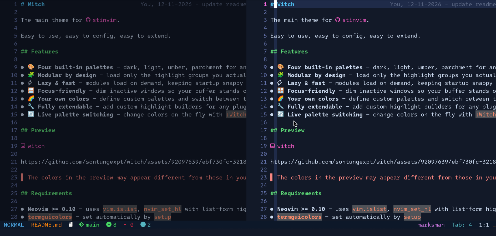
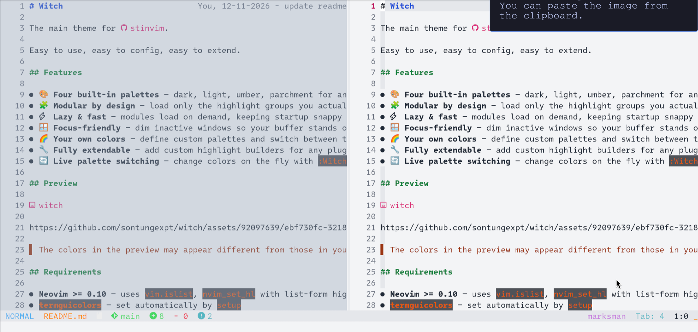
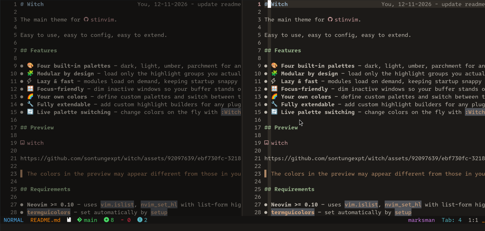
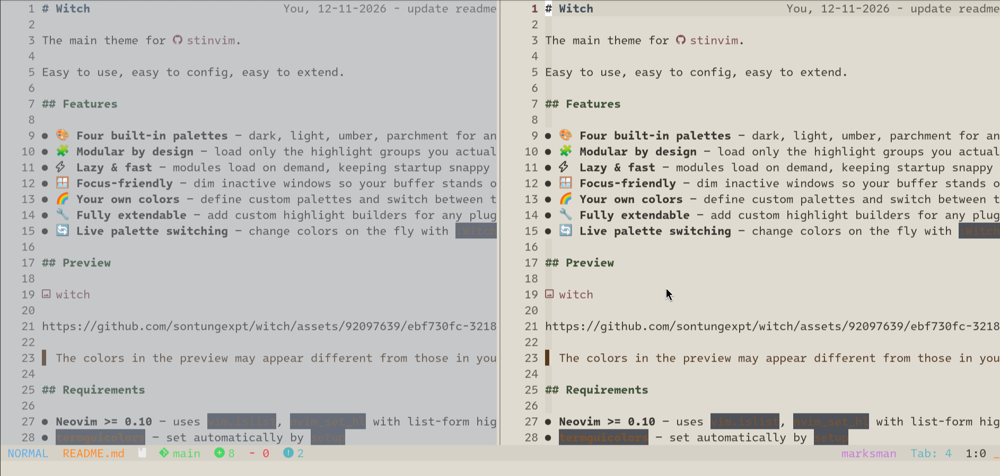
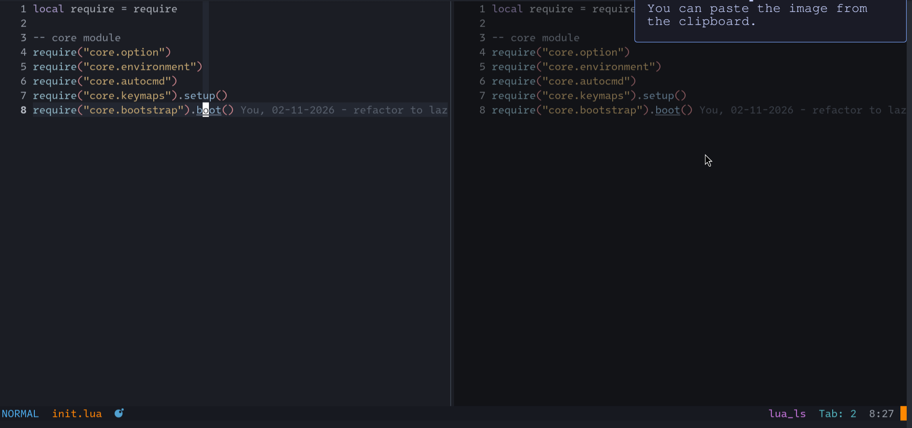

# Witch

The main theme for [stinvim](https://github.com/sontungexpt/stinvim).

Easy to use, easy to config, easy to extend.

## Features

- 🎨 **Five built-in palettes** — umber, dark, light, parchment, nocturne for any lighting condition
- 🧩 **Modular by design** — load only the highlight groups you actually use
- ⚡ **Lazy & fast** — modules load on demand, keeping startup snappy
- 🪟 **Focus-friendly** — dim inactive windows so your buffer stands out
- 🌈 **Your own colors** — define custom palettes and switch between them instantly
- 🔧 **Fully extendable** — add custom highlight builders for any plugin
- 🔄 **Live palette switching** — change colors on the fly with `:Witch <palette>`

## Preview

| Palette     | Preview                                               |
| ----------- | ----------------------------------------------------- |
| `dark`      |            |
| `light`     |          |
| `umber`     |          |
| `parchment` |  |
| `nocturne`  |    |

https://github.com/sontungexpt/witch/assets/92097639/ebf730fc-3218-427f-b8a5-ae0fa5895532

> The colors in the preview may appear different from those in your Vim due to potential errors during color conversion.

## Requirements

- **Neovim >= 0.10**

## Quick Start

```lua
-- lazy.nvim
{
    "sontungexpt/witch",
    priority = 1000,
    lazy = false,
    config = function(_, opts)
        require("witch").setup(opts)
    end,
}

-- your config
require("witch").setup({ palette = "dark" })
```

Switch palettes anytime with `:Witch light`, `:Witch umber`, or `:Witch parchment`. Tab-completion works over all built-in palettes.

## Installation

```lua
-- lazy.nvim
{
    "sontungexpt/witch",
    priority = 1000,
    lazy = false,
    config = function(_, opts)
        require("witch").setup(opts)
    end,
}
```

## Setup

Minimal setup:

```lua
require("witch").setup({ palette = "dark" })
```

Full example with every option:

```lua
require("witch").setup({
    -- Active palette name.
    -- Built-in: "umber" (default), "dark", "light", "parchment", "nocturne".
    -- Custom: reference your `palletes` key with the first letter lowercased.
    palette = "umber",

    -- User-defined custom palettes. Keys must start with an uppercase
    -- letter (e.g., `MyPalette`) and are referenced as `myPalette`.
    palletes = {},

    -- Dim inactive windows.
    dim = {
        enabled = true,
        level = 0.35,       -- 0 = no dimming, 1 = fully dimmed
        fade_bg = true,      -- also fade background groups
        excluded = {
            filetypes = { NvimTree = true },
            buftypes  = { nofile = true, prompt = true, terminal = true },
        },
    },

    -- Per-module configuration. Enabled by default:
    -- core, treesitter, lsp, terminal, markup, blink-cmp, bracket, indentline.
    modules = {
        core       = { lazy = false, enabled = true },
        treesitter = { event = "FileType", enabled = true },
        lsp        = { event = "LspAttach", enabled = true },
        ["blink-cmp"] = { event = { "InsertEnter", "CmdlineEnter" }, enabled = true },
        terminal   = { event = "TermOpen", enabled = true },
        bracket    = { event = "CursorHold", enabled = true },
        indentline = { event = "CursorHold", enabled = true },
        markup     = { ft = { "markdown", "latex", "tex", "html", "typst", "org", "rst", "xml" }, enabled = true },

        -- Disabled by default — add `enabled = true` to use them.
        nvimtree   = { ft = "NvimTree" },
        cmp        = { event = { "InsertEnter", "CmdlineEnter" } },
        gitsigns   = { event = { User = "GitSignsUpdate" } },
        dap        = {},
        diffview   = { event = "CursorHold" },
        notify     = { event = "CursorHold" },
        navic      = { event = "LspAttach" },
    },
})
```

`setup` may be called multiple times — each call merges your options into the existing config and clears the plugin's augroup before rebuilding lazy-load autocmds. Witch also enables `termguicolors` automatically during setup.

The `dim.excluded` tables accept either a map (`{ NvimTree = true }`) or a plain list (`{ "NvimTree" }`).

## Modules

Each entry in `modules` is a `Module`:

```lua
--- @class Module
--- @field enabled? boolean                 Whether the module is enabled. Defaults to false.
--- @field build?   fun(palette, palette_name): table[]  Highlight builder.
--- @field lazy?    boolean                 If `false`, load during setup.
--- @field ft?      string|string[]         Filetype(s) that trigger loading.
--- @field event?   string|string[]|table<string, string|string[]>  Event trigger(s).
```

### Built-in modules

All modules below ship with Witch. Each maps to a `build` function under `lua/witch/builder/core/<name>.lua` or `lua/witch/builder/extra/<name>.lua`; you can enable, disable, override triggers, or replace its `build` from `setup`.

| Name         | Highlights                                                                                                                                 |
| ------------ | ------------------------------------------------------------------------------------------------------------------------------------------ |
| `core`       | Base editor groups — `Normal`, `Comment`, `Visual`, `Search`, `StatusLine`, popups, borders, etc. **Required** — every palette expects it. |
| `treesitter` | Tree-sitter capture groups — `@function`, `@keyword`, `@variable`, `@type`, `@string`, …                                                   |
| `lsp`        | LSP semantic tokens and diagnostic groups (`DiagnosticError`, …).                                                                          |
| `blink-cmp`  | [blink.cmp](https://github.com/Saghen/blink.cmp) completion menu.                                                                          |
| `cmp`        | [nvim-cmp](https://github.com/hrsh7th/nvim-cmp) completion menu (alternative to `blink-cmp`).                                              |
| `terminal`   | `:terminal` buffer groups — `TermCursor`, terminal color table.                                                                            |
| `bracket`    | [nvim-ts-autotag](https://github.com/windwp/nvim-ts-autotag)-style / rainbow bracket pairs.                                                |
| `indentline` | Indent guide characters (`IblIndent`, `IblScope`, …).                                                                                      |
| `markup`     | Markup-specific groups — headings, code blocks, links, tables.                                                                           |
| `nvimtree`   | [nvim-tree.lua](https://github.com/nvim-tree/nvim-tree.lua) explorer.                                                                      |
| `gitsigns`   | [gitsigns.nvim](https://github.com/lewis6991/gitsigns.nvim) add/change/delete signs.                                                       |
| `dap`        | [nvim-dap](https://github.com/mfussenegger/nvim-dap) + [nvim-dap-ui](https://github.com/rcarriga/nvim-dap-ui).                             |
| `diffview`   | [diffview.nvim](https://github.com/sindrets/diffview.nvim) diff panes.                                                                     |
| `notify`     | [nvim-notify](https://github.com/rcarriga/nvim-notify) popups.                                                                             |
| `navic`      | [nvim-navic](https://github.com/SmiteshP/nvim-navic) breadcrumb icons and text.                                                            |

To list them at runtime:

```lua
:lua =vim.tbl_keys(require("witch.config").modules)
```

### `build`

Optional. If omitted, Witch falls back to `require("witch.builder").require(name)`.

If provided, it **must** create and return the highlight table **inside the function body**:

```lua
build = function(palette, palette_name)
    return {
        { "MyGroup", fg = palette.fg, bg = palette.bg, bold = true },
        { "MyOtherGroup", link = "Normal" },
    }
end
```

Each entry is `{ group_name, <nvim_set_hl options> }`. `group_name` is stripped before `nvim_set_hl` is called.

#### ❌ Do not close over an outer table

```lua
local my_highlights = { { "MyGroup", fg = "#ffffff" } }  -- BAD

build = function(palette, palette_name)
    return my_highlights   -- ❌ closure over an outer table
end
```

#### Why

1. **The plugin mutates your table.** `load_module` does `hl[1] = nil` on each entry before calling `nvim_set_hl` (to strip `group_name`, which is not a valid `nvim_set_hl` field). After the first load, every entry in your outer table has `[1] = nil`. On the next `:Witch <palette>` (or the next `setup` call), `hl_name` is `nil` → `nvim_set_hl(0, nil, ...)` errors or silently corrupts your highlights. Reusing the same table across calls is **unsafe by construction** — Witch cannot guarantee it won't rewrite entries.
2. **Memory** — Witch consumes the returned table then drops it. An outer table stays allocated for the whole session even though `nvim_set_hl` already copied its values. Building inside `build` lets the GC reclaim it immediately.
3. **Never reused** — `nvim_set_hl` copies colors into Neovim's store; the Lua table is dead weight afterwards.
4. **Palette correctness** — `build` runs again on every `:Witch <palette>`. An outer table holds stale colors and will re-apply them on palette switch.
5. **No hidden state** — `setup` can be called multiple times; outer tables are captured once and never refresh.

### Lazy-loading rules

|    `lazy`    | `ft` / `event`                    | Behavior                                                         |
| :----------: | :-------------------------------- | :--------------------------------------------------------------- |
|   `false`    | —                                 | Loaded immediately during `setup`.                               |
| `true`/`nil` | `ft = "x"`                        | Loaded on `FileType x` (or matching type already open at setup). |
| `true`/`nil` | `event = "X"`                     | Loaded on event `X`.                                             |
| `true`/`nil` | `event = { "X", "Y" }`            | Loaded on the first of `X`/`Y`.                                  |
| `true`/`nil` | `event = { X = true }`            | Loaded on event `X`.                                             |
| `true`/`nil` | `event = { X = "pattern" }`       | Loaded on `X pattern` (glob).                                    |
| `true`/`nil` | `event = { User = "Name" }`       | Loaded on `User Name`.                                           |
| `true`/`nil` | `event = { User = { "A", "B" } }` | Loaded on `User A` or `User B`.                                  |
| `true`/`nil` | `event = { BufEnter = { "*.lua", "*.md" } }` | Loaded on the first matching glob pattern.             |
| `true`/`nil` | nothing                           | **Never loaded** — misleading config, will not fire.             |

Triggers are batched into a single autocmd per group (FileType, pattern-less events, `User` events). Glob-pattern events (`BufEnter = "*.lua"` etc.) are not batched — one autocmd per module, self-destructing after the first match.

## Palettes

### Built-in

| Name        | Description           |
| ----------- | --------------------- |
| `umber`     | Warm dark palette (default).  |
| `dark`      | Dark palette. |
| `light`     | Light palette.        |
| `parchment` | Warm light palette.   |
| `nocturne`  | Cool dark palette.    |

### Custom

Add your own palette under `palletes`. Keys must start with an uppercase letter; at runtime the palette is referenced by the same name with the first letter lowercased (key `MyPalette` → `myPalette`):

```lua
require("witch").setup({
    palletes = {
        -- Key starts with an uppercase letter; referenced as `myPalette`.
        MyPalette = {
            bg       = "#161f31",
            fg       = "#c9d8ee",
            comment  = "#5c6a7d",
            keyword  = "#c678dd",
            -- ...
        },
    },
    palette = "myPalette",
})
```

> **Important:** a custom palette is used **as-is** — its fields are **not** merged with any built-in palette. Any field you leave out simply stays unset, so groups relying on it render without that color. The easiest way to build one is to start from a built-in palette and extend it:

```lua
local palette = require("witch.palette.umber")

require("witch").setup({
    palletes = {
        MyPalette = vim.tbl_extend("force", palette, {
            comment = "#5c6a7d",   -- override only what you want
            keyword = "#c678dd",
        }),
    },
    palette = "myPalette",
})
```

### Palette schema

Every palette is a single flat table of named color slots. A palette must define every field it needs — see the `vim.tbl_extend` recipe above for how to derive one from a built-in palette.

#### `Color`

Each field accepts one of two forms:

| Form           | Example     | Notes              |
| -------------- | ----------- | ------------------ |
| Hex string     | `"#1e1e2e"` | `"#rrggbb"` format |
| 24-bit integer | `0x1e1e2e`  | `0xrrggbb` format  |

```lua
palletes = {
    MyPalette = {
        bg = "#1e1e2e",   -- hex string
        fg = 0xcdd6f4,    -- 24-bit integer
    },
},
```

#### UI Surfaces

| Field | Description |
| --- | --- |
| `bg`                | Canonical editor background. |
| `bg_float`          | Floating windows and secondary popups. |
| `bg_block`          | Recessed surfaces — code blocks, terminal, quotes. |
| `bg_panel`          | Sidebars, explorers and secondary panels. |
| `bg_bar`            | Statusline, tabline and winbar. |
| `bg_gutter`         | Sign column, line number and fold column. |
| `bg_visual`         | Visual selection and selected text. |
| `bg_popup_selected` | Selected completion/menu item. |
| `bg_cursorline`     | `CursorLine` and `CursorColumn`. |
| `bg_reference`      | LSP reference highlights. |
| `bg_signature`      | Active LSP signature parameter. |
| `bg_diff_add`       | Added-line background. |
| `bg_diff_change`    | Changed-line background. |
| `bg_diff_delete`    | Deleted-line background. |

#### Text hierarchy

| Field | Description |
| --- | --- |
| `fg`           | Primary editor text. |
| `fg_strong`    | Important text, headings and emphasis. |
| `fg_muted`     | Secondary text and navigation metadata. |
| `fg_subtle`    | Low-emphasis but readable secondary text. |
| `fg_disabled`  | Disabled text that remains identifiable. |
| `fg_invisible` | Non-essential structural decoration only. |

#### Cursor

| Field | Description |
| --- | --- |
| `cursor`      | Cursor background. |
| `cursor_text` | Foreground rendered underneath the cursor. |

#### Borders and separators

| Field | Description |
| --- | --- |
| `border`        | Standard floating-window and panel border. |
| `border_focus`  | Focused window / active panel border. |
| `border_subtle` | Quiet separators, splits and scrollbar details. |

#### Syntax — comments & literals

| Field | Description |
| --- | --- |
| `comment`  | Comments and documentation. |
| `string`   | String and character literals. |
| `number`   | Number and floating-point literals. |
| `boolean`  | Boolean literals. |
| `constant` | Constants and enum members. |

#### Syntax — language structure

| Field | Description |
| --- | --- |
| `keyword`  | Keywords, statements, conditionals and imports. |
| `preproc`  | Preprocessor, annotations, decorators and macros. |
| `operator` | Operators. |

#### Syntax — callable entities

| Field | Description |
| --- | --- |
| `fn`         | Functions, methods and calls. |
| `fn_builtin` | Built-in functions. |

#### Syntax — types

| Field | Description |
| --- | --- |
| `type`         | Types, structs, classes and interfaces. |
| `type_builtin` | Built-in types. |

#### Syntax — variables & members

| Field | Description |
| --- | --- |
| `variable`         | Ordinary identifiers. |
| `variable_builtin` | Built-in variables (`self`, `this`, …). |
| `parameter`        | Function parameters. |
| `property`         | Object fields and struct members. |
| `namespace`        | Modules, packages and namespaces. |

#### Syntax — special tokens & punctuation

| Field | Description |
| --- | --- |
| `special`   | Escape sequences and special characters. |
| `delimiter` | Brackets and punctuation. |
| `link`      | Navigation links and references. |

#### Diagnostics

| Field | Description |
| --- | --- |
| `error`       | LSP `ERROR`, `healthError` and `SpellBad`. |
| `warn`        | LSP `WARN`, `healthWarning` and `SpellCap`. |
| `info`        | LSP `INFO` and `SpellLocal`. |
| `hint`        | LSP `HINT` and `SpellRare`. |
| `todo`        | `TODO`, `FIXME` and related annotations. |
| `unnecessary` | Unnecessary code and semantically dimmed content. |

> Diagnostics should primarily use foregrounds, signs and undercurl. Avoid large, highly saturated diagnostic backgrounds.

#### Search

| Field | Description |
| --- | --- |
| `search`           | Search foreground. |
| `search_bg`        | Ordinary search background. |
| `search_active`    | Active search foreground. |
| `search_active_bg` | Active search background. |

> Keep search states distinguishable without excessive luminance.

#### Raw accents

Raw hues for reusable semantic accents. Use only when no dedicated semantic field is appropriate — examples: rainbow delimiters, git signs, plugin badges.

| Field | | Field | | Field |
| --- | --- | --- | --- | --- |
| `red`     | | `cyan`    | | `pink`    |
| `orange`  | | `blue`    | | `teal`    |
| `yellow`  | | `purple`  | | `brown`   |
| `green`   | | `magenta` | | `gray`    |

#### Terminal ANSI

| Field | Description | Field | Description |
| --- | --- | --- | --- |
| `term_0`  | ANSI black          | `term_8`  | ANSI bright black   |
| `term_1`  | ANSI red            | `term_9`  | ANSI bright red     |
| `term_2`  | ANSI green          | `term_10` | ANSI bright green   |
| `term_3`  | ANSI yellow         | `term_11` | ANSI bright yellow  |
| `term_4`  | ANSI blue           | `term_12` | ANSI bright blue    |
| `term_5`  | ANSI magenta        | `term_13` | ANSI bright magenta |
| `term_6`  | ANSI cyan           | `term_14` | ANSI bright cyan    |
| `term_7`  | ANSI white          | `term_15` | ANSI bright white   |

### 💡 Example: dim unused functions

`unnecessary` is the slot mapped to `DiagnosticUnnecessary` — the group LSP uses to flag unused functions, variables and parameters. To dim them, derive a palette from a built-in and override just that field:

```lua
local palette = require("witch.palette.umber")

require("witch").setup({
    palletes = {
        MyPalette = vim.tbl_extend("force", palette, {
            unnecessary = "#565f89",  -- e.g. reuse your comment color
        }),
    },
    palette = "myPalette",
})
```

Because Witch already maps `unnecessary` → `DiagnosticUnnecessary` in the `lsp` module, unused code is dimmed automatically — no need for `neodim` or similar plugins.

### 🔍 Inspecting the active palette

Print the active palette table:

```vim
:lua vim.print(require("witch").active_palette())
```

Or use `:Inspect` on a specific token to see which highlight group and color is actually rendered.

### 📌 Notes

- Overriding palette fields is the **recommended** way to customize — colors propagate consistently across the whole UI (diagnostics, floats, borders, diffs, …). Use the `vim.tbl_extend("force", builtin, { ... })` recipe from the [Custom](#custom) section to tweak a built-in palette.
- To build a palette from scratch, copy a built-in file from `lua/witch/palette/` and edit it — it doubles as a reference for every available slot.
- If you want a completely different variant (e.g. a new light mode), override the `bg*` and `fg*` fields first — they drive most of the visual difference.

## Custom modules

Give your module a unique name and a `build` function:

```lua
require("witch").setup({
    modules = {
        ["my-highlights"] = {
            lazy = false,
            enabled = true,
            build = function(palette, palette_name)
                return {
                    { "MyGroup", fg = palette.fg, bg = palette.bg },
                    { "MyOtherGroup", link = "Normal" },
                }
            end,
        },
    },
})
```

The `build` function is called every time the module is loaded **and** every time the active palette changes (so your groups stay in sync with `:Witch <palette>`).

## Commands

| Command                       | Description                                                                                                                 |
| ----------------------------- | --------------------------------------------------------------------------------------------------------------------------- |
| `:Witch <palette>`            | Switch to the given palette. An unknown name falls back to `dark`. Tab-completes over built-in palettes.                    |
| `:colorscheme witch-<palette>` | Standard colorscheme entry points (`witch-dark`, `witch-light`, `witch-umber`, `witch-parchment`, `witch-nocturne`) — equivalent to `:Witch <palette>` after setup. |
| `:WitchDimToggle`             | Toggle dimming of inactive windows. Only registered when `dim.enabled = true`, on the first `WinNew`.                       |

`g.colors_name` is set to `witch-<palette>` after each palette switch, so `:colorscheme` (no args) reports the active palette. Every switch (via `:Witch <palette>` or `apply_palette`) also emits a `ColorScheme` autocmd with `witch-<palette>` as the pattern, so ecosystem plugins (lualine, nvim-tree, …) pick up the switch.

## Events

| `User` event          | Data         | Fired when                                                               |
| --------------------- | ------------ | ------------------------------------------------------------------------ |
| `WitchModuleLoaded`   | module name  | A module finishes building its highlights.                               |
| `WitchPaletteChanged` | palette name | `:Witch <palette>` (or `require("witch").apply_palette(...)`) completes. |

Example — react to a specific module:

```lua
vim.api.nvim_create_autocmd("User", {
    pattern = "WitchModuleLoaded",
    callback = function(ev)
        if ev.data == "nvimtree" then
            -- e.g. force NvimTree to re-render after its colors changed
            require("nvim-tree.view").redraw()
        end
    end,
})
```

### Overriding Highlights

Because Witch loads modules lazily, setting a highlight directly at startup (e.g., `vim.api.nvim_set_hl(0, "@comment", ...)`) will be overwritten when Witch eventually loads that module.

If you only want to tweak a few specific highlight groups (without writing a whole custom module), you can catch the `WitchModuleLoaded` event and use `nvim_set_hl` to surgically override the colors _after_ the module has finished loading.

```lua
vim.api.nvim_create_autocmd("User", {
    pattern = "WitchModuleLoaded",
    callback = function(ev)
        if ev.data == "treesitter" then
            -- Override specific Treesitter groups after Witch applies them
            vim.api.nvim_set_hl(0, "@comment", { fg = "#5c6370", italic = true })
            vim.api.nvim_set_hl(0, "@keyword", { fg = "#c678dd", bold = true })
        elseif ev.data == "lsp" then
            -- Tweak LSP diagnostic undercurls
            vim.api.nvim_set_hl(0, "DiagnosticUnderlineError", { undercurl = true, sp = "#e06c75" })
        end
    end,
})
```

This approach ensures your overrides survive palette switches and lazy-loading.

> **Note:** If you find yourself overriding _too many_ highlight groups, it is highly recommended to create a [Custom module](#custom-modules) instead. Alternatively, if you want to completely replace an existing module's highlights, you can simply override its `build` function directly in your `setup()`. The autocmd override approach is meant for quick, minor tweaks only.

## API

```lua
local witch = require("witch")

witch.setup(opts)              -- configure + apply
witch.apply_palette(name)      -- apply a palette programmatically
witch.active_palette_name()    -- e.g. "dark"
witch.active_palette()         -- the raw palette table
```

## Migration from v1

| v1                                  | v2                                                         |
| ----------------------------------- | ---------------------------------------------------------- |
| `theme.style = "dark"`              | `palette = "dark"`                                         |
| `theme.enabled = true`              | handled by per-module `enabled`                            |
| `theme.extras = { bracket = true }` | `modules = { bracket = { enabled = true, lazy = false } }` |
| `theme.customs = { mod }`           | `modules = { [name] = { build = fn } }`                    |
| `theme.on_highlight = fn`           | per-module `build` function                                |
| `more_themes = { X = {} }`          | `palletes = { X = {} }`                                    |
| `dim_inactive`                      | `dim` (same fields, plus `fade_bg`)                        |
| `switcher`                          | removed (`:Witch` is always available)                     |
| `User WitchHighlightDone`           | `User WitchModuleLoaded`                                   |

## Contributing

Because I follow minimalism, I just support the basic features I use.

If you need more features, please open an issue or pull request with an image or a video to show your color scheme.

Hope you enjoy it! I look forward to more highlight styles from you.

## License

This project is licensed under the MIT License — see the [LICENSE](./LICENSE) file for details.
